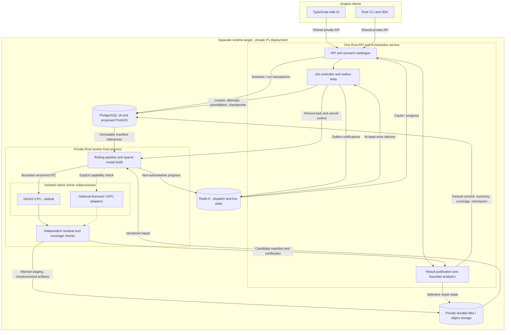

# Proposed system topology

Date: 2026-11-13. Status: **Proposed**; requirements remain unbaselined. This is an
architecture/handoff document, not a deployed system or permission to implement.
The coding container is for editing and coordination only (D-65). All databases,
solver work and qualification belong on the separate runtime target, whose final
specification is TBD. The task's owner clarification sets a planning floor of the
5900X/128 GB/consumer-NVIDIA setup described in STATUS; no target is inferred from
the container's reported CPU, memory or devices.

## Process, data and trust boundaries

PostgreSQL is the sole transactional authority. Objects hold immutable bulk inputs,
Parquet results and checkpoint payloads; PostgreSQL commits the visible manifest
pointers only after durable verification. Redis can be rebuilt or unavailable
without losing jobs/checkpoints: durable claims and reconciliation stay in PostgreSQL.
The UI never connects directly to stores or native workers. Optional adapters in
the diagram are future capabilities, not installed/qualified implementations.

## Why this shape, and what changes as it grows

ASSUMPTION (Q-O-1–Q-O-5): The four ADRs propose the design and detailed operational
defaults. All await owner adoption through the [companion questionnaire](owner-questionnaire.md).
Neither the coordinator's recommendation nor these documents records an accepted
architecture decision.

The modular monolith is a reasonable starting control plane because P1's dominant
work is a long rolling numerical pipeline, rather than independent high-volume
API services. Moving native solvers and matrix construction to private worker
processes contains crashes and blocking work. Rust module boundaries preserve
testability and later extraction without per-crate deployments.

There are real costs. One control service shares an outage/failure domain; its
analytics must be bounded. PostgreSQL-plus-Redis requires an outbox/reconciler,
and PostgreSQL-plus-objects requires a manifest publication/GC protocol. A
PostgreSQL-only dispatcher is simpler for long jobs and remains a serious option;
Redis is retained because D-3 selects it, not because queue latency is proven to
limit simulation speed. TimescaleDB and separate analytical services wait for
measured query needs. Independent microservices/workflow infrastructure become
useful when control-plane load, isolation or workflow complexity warrants them.

| Deployment step | Stable contracts | Additions / remaining decisions |
|---|---|---|
| P1 one target node | Canonical TOML/data/rules, durable jobs, isolated native workers, manifest/checkpoint protocol | Private access, one active simulation initially; qualify full-network workload and runtime inventory |
| P2 worker nodes and sweeps | Same per-child run semantics and physical rolling state | Standalone worker-host role, authenticated task transport, lazy sweep expansion/admission; windows within one run remain sequential |
| P3 shared services and optional role extraction | Market modules, solver IR, immutable result formats and task envelopes | API/controller replicas, pool placement and object storage once qualified; optional analytical service based on evidence |
| P4 tenant service | Scope-aware catalogue/job/blob interfaces and provenance | Owner-selected tenant isolation, auth, quotas, scoped credentials, audit, service SLAs and security qualification |

“Without a rewrite” means retaining scientific/domain contracts while deployment
adapters and policies evolve. It does not claim P4 tenancy is already implemented,
that migrations are free, or that tenant isolation was chosen before D-39 permits it.

## ADR navigation and owner disposition

| ADR | Proposed choice | Owner-question IDs |
|---|---|---|
| [0002 — Network/scenario model](adr/0002-network-and-scenario-data-model.md) | Permanent entity IDs, immutable dated releases and resolved TOML references | Q-O-1 |
| [0004 — Storage](adr/0004-storage-topology.md) | PostgreSQL 18 + proposed PostGIS, Redis live/dispatch, Parquet bulk data; no initial TimescaleDB | Q-O-2, Q-O-3 |
| [0005 — Execution](adr/0005-execution-topology.md) | Rust API/orchestrator, worker hosts/native subprocesses, fenced jobs/checkpoints | Q-O-4 |
| [0006 — Markets](adr/0006-market-design-plugin-model.md) | Trusted versioned Rust modules, distinct GB/I-SEM policies and later zonal/nodal alternatives | Q-O-5 |

Exactly five open architecture questions/defaults are collected in the
[owner questionnaire](owner-questionnaire.md). Existing Q-N-4 accuracy acceptance and
conditional Q-N-3 verified data gaps in PR #4 remain that PR's separate owner queue;
this proposal neither duplicates nor disposes of them.

## Design context and evidence

Read against `main` at `87d57af13d225554e8edf4b0471b3aa4763584ae` and PR #4 branch
`t3/design-review-mvp-requirements-adrs` at
`1698c4be11b7c825a9bf4efd0c3c6257a02fcef4`, fetched on 2026-11-13. These are evidence
snapshots, not a dependency on merging that branch into this one. Reconcile any
later PR #4 changes during review; do not copy its files into this PR.

| Source | Architectural consequence |
|---|---|
| [Decisions D-1–D-65](../requirements/03-decisions-log.md) | Owner authority; no invented data/tenancy/market decisions |
| [PR #4 proposed requirements](https://github.com/Tobechukwu-Njoku/energy-grid-simulator/blob/1698c4be11b7c825a9bf4efd0c3c6257a02fcef4/docs/requirements/04-requirements.md) | Dated/as-of inputs, manifests, staged P1 fidelity, retention and honest validation limits |
| [PR #4 ADR 0001](https://github.com/Tobechukwu-Njoku/energy-grid-simulator/blob/1698c4be11b7c825a9bf4efd0c3c6257a02fcef4/docs/architecture/adr/0001-repo-layout-and-ci-gates.md) | Existing workspace/crate responsibilities and post-baseline quality gates |
| [PR #4 ADR 0003](https://github.com/Tobechukwu-Njoku/energy-grid-simulator/blob/1698c4be11b7c825a9bf4efd0c3c6257a02fcef4/docs/architecture/adr/0003-optimisation-modelling-layer-and-solver-trait.md) | Pre-pass/UC/redispatch/pricing, native isolation, rolling state, explicit capability/cancellation rules |
| [Stack candidates](stack-candidates.md) and [prior art](../research/prior-art.md) | Candidate/reuse evidence only; no automatic adoption, especially OSM/share-alike datasets prohibited by D-56 |
| [Dependency-licence research](../research/dependency-licences.md) | Separate software/service terms and dataset permissions; release/source details in ADR 0004 |

Primary evidence establishes available mechanisms and licence texts, not measured
scale, installed runtime hardware, legal clearance, scientific accuracy or completed
implementation. Architecture qualification plans are deliberately post-baseline.

## Coordinator handoff

This branch adds only the four Proposed ADRs, this topology and the companion
questionnaire. STATUS.md, the decisions log and every PR #4 file remain untouched,
as instructed. The coordinator owns the STATUS update, owner dispositions and any
integration edits to the canonical questionnaire or PR #4 contracts. Independent
document review and adversarial review/triage under D-28/D-53/D-54 remain required
before merge; no review or benchmark success is asserted here.
