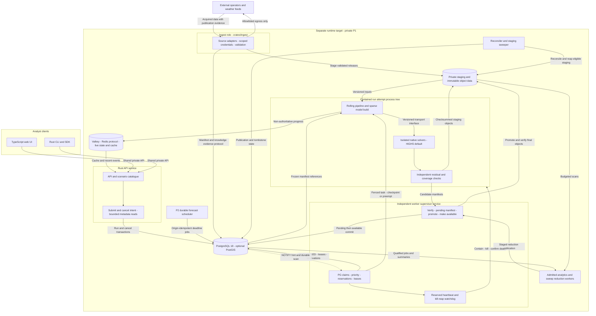

# Proposed system topology

Date: 2026-11-13. Status: **Proposed**; requirements remain unbaselined. This is an
architecture/handoff document, not permission to implement. The coding container is
for editing/coordination only; databases, solvers and qualification belong on the
separate runtime target, whose specification is still TBD (D-65).

ASSUMPTION: D-48's 5900X/128 GB is a provisional planning floor pending the D-65
target inventory, tracked under Q-H-7 in the canonical questionnaire. It is not a
confirmed target or GPU specification; container resources establish neither.

## Process, data and trust boundaries

PostgreSQL is the sole job/metadata authority; P1 dispatch uses SKIP LOCKED/leases
and durable scans, with NOTIFY only a hint. Valkey is the D-67 BSD-3-Clause
default; Redis is a compatible alternative. Application clients use only their
shared Redis protocol. Neither service dispatches jobs or owns completion.

The API and worker supervisor have separate service lifecycles from P1. API restarts
do not kill runs. Before lease reclaim, confirm the old attempt tree is dead, then
recheck and reserve memory before starting a successor. Heavy analytics run in
admitted workers outside API/supervisor; heartbeats retain dedicated headroom.

Ingest (`crates/ingest`, D-62) is the acquisition writer for ADR 0002's effective,
publication and acquisition times. It owns external egress/credentials, validates
D-56 lineage and stages immutable releases through ADR 0004's publication contract.
Historical ingest is P1; continuous feeds and a PostgreSQL-backed forecast-origin
scheduler are P2. Missing vintages/deadlines are explicit, not silently replaced.
Forecast priority and checkpoint/preemption fields fit the job model from the start.

Bulk inputs/results and checkpoints use staging → committed pending manifest →
promotion → verified available pointers. APIs see only available manifests. A
periodic N-hour staging sweeper (proposed N=24) uses listings for cleanup, never as
a commit protocol. PostgreSQL pin/tombstone transitions precede object deletion.
Resume verifies all prior interval objects; expired state requires a new run from
the start. No completion is possible with missing requested intervals.

The transport interface uses versioned envelopes and authorised blob references;
local fd passing is an optional adapter. Network transport can use the same engine
contract. Native/licensed/GPU capabilities need explicit qualification, not silent
backend substitution. The UI never directly accesses stores or native workers.

## Why this shape, and what changes as it grows

D-22 delegates engineering defaults to agents; the four ADRs remain Proposed until
accepted. Only four product choices are in the
[owner questionnaire](owner-questionnaire.md), registered in the canonical queue.
No new decision is recorded here.

A modular API keeps domain/interface semantics together. Independent supervision
contains native failures and preserves long runs across API deployments without
turning every crate into a microservice. PostgreSQL-only dispatch avoids a redundant
broker relay; Valkey remains useful for rebuildable live state. Cross-store publication,
physical fencing, checkpointing and backup/GC still have real operational costs.
No throughput or latency advantage is claimed without target qualification.

| Phase | Stable contracts | Additions / remaining evidence |
|---|---|---|
| P1 one target node | Canonical TOML/releases, PG jobs, separately supervised workers, manifest/checkpoint state | Private access, one simulation reservation initially; historical ingest; bounded worker analytics; target inventory/qualification |
| P2 forecasts and sweeps | Same origin/child run identities, physical state, priority/preemption fields and transport interface | Continuous feeds, durable forecast schedules, deadline class preempting research or reserved capacity; authenticated worker nodes and fair research resumption |
| P3 shared services | Market modules, solver IR, immutable formats and task envelopes | API replicas/pools and qualified shared objects; optional control extraction after measurements |
| P4 tenant service | Scope-aware catalogue/jobs/blobs and provenance | Owner-selected isolation, auth/quotas/audit, scoped credentials and availability objectives; decide customer-code policy |

“Without a rewrite” preserves scientific/domain/task contracts as transport and
scheduling adapters evolve. It does not promise free migrations, already implemented
tenancy or deadline success with missing feeds/insufficient compute. On a constrained
host, forecast preemption kills/reaps research before admission; it never overlaps
two reservations beyond the RAM budget.

## ADR navigation and owner disposition

| ADR | Proposed choice | Owner product disposition |
|---|---|---|
| [0002 — Data model](adr/0002-network-and-scenario-data-model.md) | Permanent IDs, dated immutable releases, resolved TOML and explicit numerical identity | Q-O-1 answers Q-D-5 for historical/repeatability claims |
| [0004 — Storage](adr/0004-storage-topology.md) | PostgreSQL 18, optional P1 PostGIS, Valkey live state, Parquet bulk data; no initial TimescaleDB | Q-O-3 answers Q-I-5; Q-O-2 deprecated as engineering detail |
| [0005 — Execution](adr/0005-execution-topology.md) | Separate API/supervisor, PG dispatch, physical fencing, ingest and schedules | New Q-O-6 forecast priority; Q-O-4 deprecated as engineering detail |
| [0006 — Markets](adr/0006-market-design-plugin-model.md) | Trusted Rust modules, distinct GB/I-SEM policies, reported repair fallback and P3 alternatives | Q-O-5 answers Q-J-2 for customer market-code uploads before P4 |

The four choices are answered: Q-O-1 → D-70, Q-O-3 → D-67, Q-O-5 → D-69 and
Q-O-6 → D-68. Stable Q-O-2/Q-O-4 are deprecated, not renumbered. Q-C-6/Q-I-6 and
Q-H-4/Q-H-6 retain their scope; D-66/D-71 answer PR #4’s accuracy/data-gap questions.
Target inventory clarification is still tracked in Q-H-7 (D-65).

## Design context and evidence

Main and PR #4 branch `t3/design-review-mvp-requirements-adrs` at
`6c6a9eb23de98e5de9addd57eb03799b6a26834d` are merged on 2026-11-13; requirements
and ADRs 0001/0003 are now local rather than an unmerged historical snapshot.
The questionnaire conflict is resolved with both N and O sections and the owner
answers preserved. ADR 0006 uses ADR 0003’s bounded non-convergence fallback:
three repair re-solves, one 300-second recovery MILP and a 900-second total window
budget, then failed/partial only if no valid fallback state exists. ADR 0005 refines
ADR 0001’s engine lifecycle boundary without making API restarts own worker lifetime.

| Source | Architectural consequence |
|---|---|
| [Decisions D-1–D-71](../requirements/03-decisions-log.md) | Owner authority; no invented data/tenancy/market decisions |
| [Merged PR #4 proposed requirements](../requirements/04-requirements.md) | Dated/as-of inputs, manifests, staged P1 fidelity, retention and D-66 reconstruction gates |
| [Merged PR #4 ADR 0001](adr/0001-repo-layout-and-ci-gates.md) | Workspace/crate responsibilities and post-baseline quality gates |
| [Merged PR #4 ADR 0003](adr/0003-optimisation-modelling-layer-and-solver-trait.md) | Pre-pass/UC/redispatch/pricing, bounded recovery, native isolation and rolling/cancellation rules |
| [Stack candidates](stack-candidates.md) and [prior art](../research/prior-art.md) | Candidate/reuse evidence only; no automatic adoption, especially OSM/share-alike datasets prohibited by D-56 |
| [Dependency-licence research](../research/dependency-licences.md) | Separate software/service terms and dataset permissions; release/source details in ADR 0004 |

Primary evidence establishes available mechanisms and licence texts, not measured
scale, installed runtime hardware, legal clearance, scientific accuracy or completed
implementation. Architecture qualification plans are deliberately post-baseline.

## Coordinator handoff

Revisions and finding dispositions are recorded in the
[PR #17 response](../requirements/reviews/response-pr17-2026-11-13.md).
The canonical questionnaire records the four answered product choices and
mapped/deprecated IDs. STATUS.md and the decisions log are inherited from main
without edits; the coordinator owns any session status update.
No application code was written. PR #4’s scientific fallback and crate boundaries
are integrated; D-65 target hardware/OS/access and post-baseline qualification remain
outstanding. Current-head review disposition and baseline/ADR adoption remain prerequisites
to baseline/merge; no runtime qualification is asserted here.
