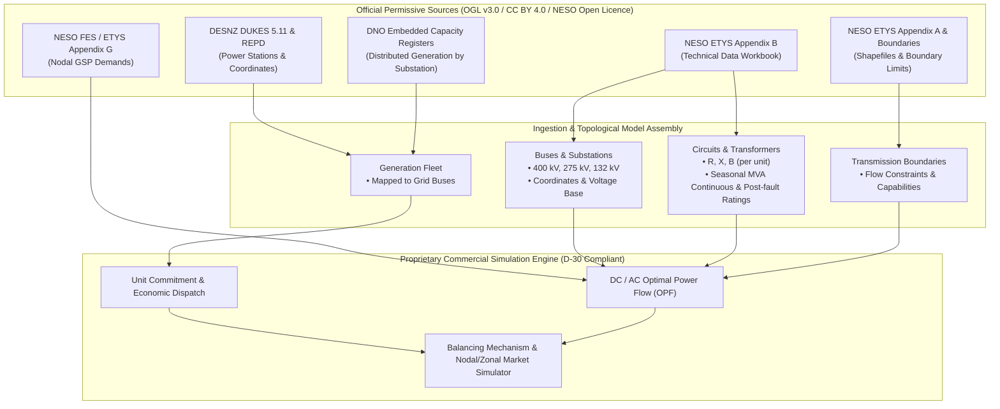

# Great Britain Electricity Data Sources Catalogue

_Last updated / Sources checked: 2026-11-12._

---

## 1. Executive Summary

This catalogue audits Great Britain (England, Scotland, Wales) electricity datasets for building a commercial SaaS electricity grid simulation and market modeling platform. In accordance with architectural decision **D-30**, all datasets must be **commercially permissive and non-share-alike** (strictly avoiding copyleft/share-alike licences such as ODbL or CC BY-SA to protect proprietary SaaS IP).

### Commercial Usability Status

* **Fully Usable for Commercial Products (Permissive / Non-Share-Alike):**
  * **Elexon BMRS / Insights Solution**: Operates under the **BSC Open Data Licence** (compatible with CC BY 4.0). Permits commercial reproduction, adaptation, and integration into commercial SaaS products without share-alike obligations, subject to statutory source attribution.
  * **NESO Data Portal & Future Energy Scenarios (FES)**: Operates under the **National Energy SO Open Data Licence v1.0** (modelled directly on OGL v3.0, CC BY 4.0 compatible). Permits unrestricted commercial exploitation and derivative works with attribution.
  * **NESO Electricity Ten Year Statement (ETYS)**: Operates under the **NESO Open Data Licence**. Full technical network parameters, substations, boundaries, and transformer data can be incorporated commercially without share-alike restrictions.
  * **DESNZ REPD & DUKES (Table 5.11)**: Released under the **Open Government Licence v3.0 (OGL v3.0)**. Free commercial exploitation permitted.
  * **Distribution Network Operators (DNOs) Open Portals & Embedded Capacity Registers (ECRs)**: Released under **CC BY 4.0** or **OGL v3.0** / custom Open Data Licences based on OGL v3.0 across all 6 DNOs.
  * **Transmission Owners (NGET, SP Transmission, SSEN Transmission)**: High-level system publications, open portal datasets, and network development statements are licensed under **OGL v3.0** or **CC BY 4.0**.
  * **Ofgem Data Portal**: Crown copyright under **OGL v3.0**.
  * **NESO Carbon Intensity API**: Open access under **CC BY 4.0**.
  * **Crown Estate / Crown Estate Scotland Offshore Wind GIS**: Released under **Crown Estate Open Data Licence / OGL v3.0**.

* **Blocked / Commercial Licence Required (Paid or Restricted):**
  * **N2EX (Nord Pool) Day-Ahead Auction Prices**: **Proprietary and commercial**. Real-time and programmatic API access for commercial SaaS redistribution requires a paid **Nord Pool Market Data Redistribution Agreement** (base redistribution fee typically ~€5,000/annum plus user feeds). Free public web tables are strictly for delayed viewing and forbid commercial scraping or redistribution.
  * **EPEX SPOT GB Day-Ahead Auction Prices**: **Proprietary and commercial**. Clearing prices are governed by the **EPEX SPOT General Conditions of Data Use / EEX Group**. Programmatic API access or client-facing redistribution requires a formal, paid **EPEX SPOT Market Data Agreement / Redistribution Licence** (starting at >€1,040/month for automated API access).
  * **Elexon BMRS Market Index Data (MID)**: While general BMRS data is open under the BSC Open Data Licence, Market Index Data derived from EPEX SPOT and Nord Pool is expressly carved out under the third-party exemption clause.
  * **Detailed DNO Underground Asset Geometries & Secondary Substation Internals**: Granular low-voltage CAD/GIS conductor traces and secondary substation schematics are classified as **Shared Data** under the **Energy Networks Association (ENA) Shared Data Licence**. Access requires approved organizational justification and strictly prohibits open third-party commercial software redistribution.

---

### Core Finding: Transmission Network Model Feasibility

> [!IMPORTANT]
> **Can a complete Great Britain transmission network with impedances and ratings be built from non-share-alike sources?**
>
> **YES.** A complete, high-fidelity transmission network model for Great Britain (400 kV, 275 kV, and Scottish 132 kV) can be constructed entirely from non-share-alike, commercially permissive public sources without any reliance on OpenStreetMap (OSM) or ODbL-contaminated datasets:
> 1. **Network Topology, Substations, and Branches**: Published annually by NESO in the **Electricity Ten Year Statement (ETYS) Appendix B (System Technical Data)** under the **NESO Open Data Licence** (compatible with CC BY 4.0 and OGL v3.0). Appendix B lists every transmission substation/node, node-to-node connectivity, circuit lengths, and operational voltage levels.
> 2. **Electrical Parameters ($R, X, B$)**: ETYS Appendix B provides positive-sequence resistance ($R$), reactance ($X$), and susceptance/charging ($B$) for all transmission circuits and Supergrid / GSP transformers.
> 3. **Line Thermal Ratings**: ETYS Appendix B provides seasonal thermal ratings (Winter, Spring/Autumn, Summer) in MVA for both continuous and post-fault operational states across all circuits.
> 4. **Boundaries and Transfer Limits**: ETYS Appendix A and the NESO Data Portal provide geographic boundary shapefiles and transfer limits (e.g., B6 Scotland–England boundary) under the NESO Open Data Licence.
> 5. **Prior Validation**: Open-source implementations such as **PyPSA-GB** prove that an operational ~2,000-bus transmission power flow and dispatch model can be built directly from ETYS Appendix B and NESO FES data. By connecting ETYS substations using straight Euclidean/geodesic vectors or using official TO transmission route shapefiles licensed under OGL/CC BY, our platform avoids ODbL-licensed OpenStreetMap data completely.

---

### Key Gaps and Strategic Mitigations

1. **Exchange Day-Ahead Power Prices**: Day-ahead spot clearing prices from EPEX SPOT and Nord Pool N2EX cannot be redistributed or embedded for free.
   * _Mitigation_: In early development/MVP, simulate day-ahead nodal/zonal clearing prices natively from our unit commitment / economic dispatch engine or rely on Elexon BMRS System Imbalance Prices / System Sell & Buy Prices (which are free and open). For production commercial delivery of exchange benchmark curves, procure a commercial redistribution subscription from Nord Pool / EPEX SPOT or an authorized aggregator (e.g. Montel, Modo Energy).
2. **Sub-Transmission & Low-Voltage Cable Geometries (11 kV / LV)**: Precise GIS routes of buried distribution cables are restricted by DNOs under national infrastructure security rules (ENA Shared Data Licence).
   * _Mitigation_: Use DNO Open Data Portal Grid Supply Points (GSPs) and primary substations (33 kV / 132 kV) combined with open Embedded Capacity Registers (ECRs) and open street basemaps. Model distribution feeders synthetically or topologically at the primary substation level.

---

## 2. Comprehensive Data Sources Catalogue

| # | Name & Publisher | Official URL & API Docs | Contents & Scope | Time Coverage & Resolution | Access Method | Licence Name, Text Link & Commercial Use Clause | Commercial Allowed? / Share-Alike? | Relevance to Platform |
|---|---|---|---|---|---|---|---|---|
| **1** | **Elexon BMRS / Insights Solution** *(Elexon Limited)* | **Portal:** [insights.elexon.co.uk](https://insights.elexon.co.uk/) **API Docs:** [bmrs.elexon.co.uk/api-documentation](https://bmrs.elexon.co.uk/api-documentation) **Dev Portal:** [developer.data.elexon.co.uk](https://developer.data.elexon.co.uk) | Generation outturn by fuel type, physical notifications (PN), dynamic parameters, Balancing Mechanism (BM) bids and offers, BM acceptances (BOA), cashout/system imbalance prices (SSP/SBP), system buy/sell prices, loss of load probability (LOLP), derated margin, interconnector flows. | Real-time to historical (data from 2000s onwards; modern Insights API from ~2016–present); half-hourly (settlement period) and 1–5 min operational feeds. | REST API (`/bmrs/api/v1`), streaming via IRIS (WebSocket / STOMP), CSV web exports. Free API key registration required. | **BSC Open Data Licence** [Licence Text](https://www.elexon.co.uk/data/open-data-requests/bsc-open-data-licence/) *"Elexon grants you a worldwide, royalty-free, perpetual, non-exclusive licence to... exploit the Information commercially and non-commercially for example, by combining it with other Information, or by including it in your own product or application."* *(Attribution required: 'Contains BSC information licensed under the BSC Open Data Licence')*. Excludes third-party Market Index Data. | **Commercial: YES** **Share-Alike: NO** | **Balancing Mechanism & Market Prices:** Essential foundation for historical generation dispatch, bid/offer pair data, BM acceptances, system imbalance settlement, interconnector flows, and real-time generation outturn. |
| **2** | **NESO Data Portal** *(National Energy System Operator)* | **Portal:** [dataportal.neso.energy](https://dataportal.neso.energy/) **API Docs:** [dataportal.neso.energy/api/3/action](https://dataportal.neso.energy/) | Historical and forecast National Demand (ND) and Transmission System Demand (TSD), Initial Transmission System Demand Outturn (ITSDO), balancing services procurement and outturn (Dynamic Containment, Moderation, Regulation, STOR, Fast Reserve), Monthly Balancing Services Summary (MBSS), boundary constraint costs, operational system inertia, transmission losses, wind/solar forecasts. | Historical archive (>15 years historical) to day-ahead/week-ahead forecasts; half-hourly, daily, and monthly resolutions. | CKAN REST API (`/api/3/action/datastore_search`), direct CSV/XLSX bulk downloads. No registration required for public feeds. | **National Energy SO Open Data Licence v1.0** [Licence Text](https://www.neso.energy/data-portal/neso-open-licence) *"The Licensor grants you a worldwide, royalty-free, perpetual, non-exclusive licence to... exploit the Information commercially and non-commercially for example, by combining it with other Information, or by including it in your own product or application."* *(Attribution required: 'Supported by National Energy SO Open Data')*. Compatible with CC BY 4.0 / OGL v3.0. | **Commercial: YES** **Share-Alike: NO** | **System Demand & Ancillary Services:** Core source for actual and forecast transmission system demand curves, regional constraint expenditure, system frequency response, inertia limits, and reserve procurement. |
| **3** | **NESO Electricity Ten Year Statement (ETYS)** *(National Energy System Operator)* | **Portal:** [neso.energy/publications/etys](https://www.neso.energy/publications/electricity-ten-year-statement-etys) **Appendix B Data:** [neso.energy/.../etys-documents-and-appendices](https://www.neso.energy/publications/electricity-ten-year-statement-etys/etys-documents-and-appendices) **Data Portal Boundaries:** [dataportal.neso.energy/...](https://dataportal.neso.energy/) | **Appendix B (System Technical Data):** 400 kV, 275 kV, and Scottish 132 kV circuit connectivity, line impedances ($R, X, B$), transformer impedances, tap ranges, seasonal continuous and post-fault thermal ratings (Winter, Spring/Autumn, Summer in MVA). **Appendix A & GIS:** Transmission transfer boundaries, boundary capabilities, and boundary GIS shapefiles. **Appendix F & G:** Contracted generation and GSP nodal demand forecasts. | Published annually (latest editions 2022, 2023, 2024, 2025). Static snapshot with 10-year forward projection horizons. | Bulk workbook download (Excel `.xlsx`), GIS ESRI Shapefiles / GeoJSON via NESO Data Portal and publication repository. | **National Energy SO Open Data Licence v1.0** [Licence Text](https://www.neso.energy/data-portal/neso-open-licence) *"The Licensor grants you a worldwide, royalty-free, perpetual, non-exclusive licence to... exploit the Information commercially and non-commercially... Compatible with the Creative Commons Attribution License 4.0 and the Open Data Commons Attribution License."* | **Commercial: YES** **Share-Alike: NO** | **Transmission Network Model (Core Foundation):** The authoritative, definitive source for building the entire GB electrical transmission network topology, line impedances, bus connections, transformer parameters, and thermal branch limits without third-party share-alike dependencies. |
| **4** | **NESO Future Energy Scenarios (FES)** *(National Energy System Operator)* | **Portal:** [neso.energy/publications/future-energy-scenarios-fes](https://www.neso.energy/publications/future-energy-scenarios-fes) **Data Portal:** [dataportal.neso.energy](https://dataportal.neso.energy/) | Long-term GB energy decarbonisation pathway data (e.g., Holistic Transition, Decarbonised Gas, Pathway to 2030/2050): generation capacity projections by technology, regional EV uptake, heat pump adoption, hydrogen electrolysis, distributed storage, annual and peak demand by GSP/grid zone. | Published annually; annual projections up to 2050. | Downloadable Excel workbooks, Data Portal CKAN API endpoints. Free open download. | **National Energy SO Open Data Licence v1.0** [Licence Text](https://www.neso.energy/data-portal/neso-open-licence) *"exploit the Information commercially and non-commercially for example, by combining it with other Information, or by including it in your own product or application."* | **Commercial: YES** **Share-Alike: NO** | **Scenario Planning & Fleet Expansion:** Benchmark scenario inputs for medium/long-term generation capacity projections, demand growth, electrification of heating/transport, and storage deployment. |
| **5** | **Renewable Energy Planning Database (REPD)** *(DESNZ)* | **Portal:** [gov.uk/.../repd-quarterly-extract](https://www.gov.uk/government/publications/renewable-energy-planning-database-quarterly-extract) **Data.gov.uk:** [data.gov.uk/dataset/...](https://data.gov.uk) | Tracking of all UK renewable energy and battery storage projects ($\ge 150\text{ kW}$): technology type, electrical capacity (MWe), developer/operator, planning status (application submitted, approved, under construction, operational, decommissioned), Grid Reference (Eastings/Northings, Lat/Long), planning authority, connection point. | Historical to current; published quarterly. | Direct CSV / XLSX bulk download via GOV.UK and Data.gov.uk. No registration required. | **Open Government Licence v3.0 (OGL v3.0)** [Licence Text](https://www.nationalarchives.gov.uk/doc/open-government-licence/version/3/) *"You are free to... exploit the Information commercially and non-commercially for example, by combining it with other Information, or by including it in your own product or application."* *(Attribution required: 'Contains DESNZ information licensed under the Open Government Licence v3.0')*. | **Commercial: YES** **Share-Alike: NO** | **Generation Fleet & Development Pipeline:** Authoritative registry of all utility-scale renewable generation and battery storage assets in Great Britain, including exact coordinates and development stages for pipeline forecasting. |
| **6** | **DUKES (Digest of UK Energy Statistics) Table 5.11** *(DESNZ)* | **Portal:** [gov.uk/.../electricity-chapter-5-dukes](https://www.gov.uk/government/statistics/electricity-chapter-5-digest-of-united-kingdom-energy-statistics-dukes) **Collection:** [gov.uk/.../dukes](https://www.gov.uk/government/collections/digest-of-uk-energy-statistics-dukes) | Comprehensive list of major UK power stations (>36 MW thermal, hydro, nuclear, CCGT, biomass, and major wind): company/operator, power station name, fuel/technology type, installed capacity (MW), transmission/distribution connection, location (country/region), commissioning year. | Annual historical updates (typically published July covering the prior calendar year). | Excel workbook (`.xlsx`) and ODS bulk downloads. | **Open Government Licence v3.0 (OGL v3.0)** [Licence Text](https://www.nationalarchives.gov.uk/doc/open-government-licence/version/3/) *"You are free to... copy, publish, distribute and transmit the Information; adapt the Information; exploit the Information commercially and non-commercially..."* | **Commercial: YES** **Share-Alike: NO** | **Conventional Generation Fleet:** Establishes the authoritative baseline catalog of large thermal, CCGT, nuclear, and pumped storage power stations connected to the transmission system. |
| **7** | **Transmission Owners (TO) Data** *(NGET, SP Transmission, SSEN Transmission)* | **NGET:** [nationalgrid.com/electricity-transmission](https://www.nationalgrid.com/electricity-transmission) / [connecteddata.nationalgrid.co.uk](https://connecteddata.nationalgrid.co.uk/) **SP Transmission:** [spenergynetworks.opendatasoft.com](https://spenergynetworks.opendatasoft.com/) **SSEN Transmission:** [ssentransmission.opendatasoft.com](https://ssentransmission.opendatasoft.com/) | Transmission asset registers, circuit specifications, substation asset locations, overhead line route shapefiles, transmission outage planning registers, network reinforcement proposals, and regional network development reports. | Annual and periodic publication; spatial GIS vector layers. | Open Data Soft portals, REST APIs, GeoJSON / ESRI Shapefile downloads, technical PDF reports. Free portal registration for API tokens. | **Creative Commons Attribution 4.0 (CC BY 4.0) & OGL v3.0** [SPEN Licence](https://spenergynetworks.opendatasoft.com/p/sp-energy-networks-open-data-licence/) \| [SSEN Licence](https://ssentransmission.opendatasoft.com/terms/terms-and-conditions/) *"You are free to... adapt the Information; exploit the Information commercially and non-commercially..."* *(Note: Sensitive underground high-voltage routing maps may be restricted under ENA Shared Licence)*. | **Commercial: YES** *(for open layers)* **Share-Alike: NO** | **Transmission Asset Verification:** Provides regional transmission asset topology, substation geographic coordinates, physical asset ratings, and planned regional reinforcements from England/Wales, Southern Scotland, and Northern Scotland TOs. |
| **8** | **Distribution Network Operators (DNO) Portals & LTDS** *(UKPN, NGED, SSEN Distribution, NPg, ENWL, SP Energy Networks)* | **UKPN:** [ukpowernetworks.opendatasoft.com](https://ukpowernetworks.opendatasoft.com/) **NGED:** [dataportal2.westernpower.co.uk](https://dataportal2.westernpower.co.uk/) **SSEN:** [data.ssen.co.uk](https://data.ssen.co.uk/) **NPg:** [northernpowergrid.opendatasoft.com](https://northernpowergrid.opendatasoft.com/) **ENWL:** [electricitynorthwest.opendatasoft.com](https://electricitynorthwest.opendatasoft.com/) **SPEN:** [spenergynetworks.opendatasoft.com](https://spenergynetworks.opendatasoft.com/) | **Long-Term Development Statements (LTDS):** 132 kV and 33 kV network topology, primary substation transformer ratings, headroom/capacity headroom, fault levels, geographic network diagrams, and CIM (Common Information Model) network exports. **Open Portals:** Substation load profiles, EV/PV connection metrics, flexibility tenders. | Annual LTDS updates (regulatory standard under licence condition 25); portal datasets updated monthly to near real-time. | Opendatasoft REST APIs (v2), bulk CSV, Shapefiles, GeoJSON, CIM XML files. Free registration required for API tokens. | **CC BY 4.0 / OGL v3.0 / DNO Open Data Licences** [UKPN Terms](https://ukpowernetworks.opendatasoft.com/) \| [NGED Licence](https://www.nationalgrid.co.uk/open-data-licence) \| [NPg Licence](https://northernpowergrid.opendatasoft.com/) All DNO open portals grant royalty-free, perpetual commercial use with attribution. *(Restricted secondary/underground CAD data requires bilateral ENA Shared Data Licence)*. | **Commercial: YES** *(open tiers)* **Share-Alike: NO** | **Distribution & Grid Supply Points (GSPs):** Crucial for modeling the interface between transmission and distribution (132 kV / 33 kV), primary substation load allocation, distributed flexibility, and distribution capacity bottlenecks. |
| **9** | **Embedded Capacity Registers (ECR)** *(All 6 GB DNOs / ENA Standard)* | **ENA Hub:** [energynetworks.org/.../connections-data](https://www.energynetworks.org/industry-hub/resource-library/connections-data.html) **Individual DNO open portals** (search `Embedded Capacity Register`) | Complete registry of all distributed generation, battery storage, and active flexibility resources ($\ge 1\text{ MW}$, with several DNOs reporting down to 50 kW) connected or accepted to connect: site name, technology, generation type, maximum export/import capacity (MW), connection status, GSP and primary substation association. | Updated monthly by all 6 DNOs. Snapshot of current connected and contracted pipeline. | Standardised tabular downloads (CSV / XLSX) and REST API datastores via DNO open data portals. | **CC BY 4.0 / OGL v3.0** Standardised under Ofgem Data Best Practice Guidance and ENA Open Networks project. Publicly accessible and reusable commercially with attribution. | **Commercial: YES** **Share-Alike: NO** | **Distributed Generation Fleet:** Critical for allocating embedded solar, onshore wind, battery storage, and reciprocating gas engines to specific GSP buses in the transmission power flow model. |
| **10** | **N2EX / EPEX SPOT GB Day-Ahead Power Prices** *(Nord Pool AS & EPEX SPOT SE)* | **Nord Pool:** [nordpoolgroup.com](https://www.nordpoolgroup.com/) / [developers.nordpoolgroup.com](https://developers.nordpoolgroup.com/) **EPEX SPOT:** [epexspot.com](https://www.epexspot.com/) / [webshop.eex-group.com](https://webshop.eex-group.com/) | Day-Ahead hourly/half-hourly auction clearing prices (£/MWh), aggregated purchase/sale order curves, intraday continuous volume-weighted prices, and auction cleared volumes for Great Britain. | Hourly/half-hourly settlement periods; real-time clearing feed and historical archive (>10 years). | Commercial REST APIs, SFTP servers, and authenticated data feeds. Public web views delayed by 24h. | **Proprietary Commercial Licences** [Nord Pool Terms](https://www.nordpoolgroup.com/trading/market-data/) \| [EPEX Data Conditions](https://www.epexspot.com/en/market-data) *Free tier strictly restricts data to personal viewing on web. Commercial usage, algorithmic dispatch, and software redistribution require paid bilateral Market Data Agreements.* | **Commercial: BLOCKED (Paid Contract Required)** **Share-Alike: NO (Proprietary)** | **Wholesale Price Benchmarks:** Benchmark day-ahead wholesale electricity price signals for GB. (Must use internal model dispatch / BMRS cashout prices or pay exchange licensing fees). |
| **11** | **Ofgem Data Portal & Research Hub** *(Office of Gas and Electricity Markets)* | **Portal:** [ofgem.gov.uk/data](https://www.ofgem.gov.uk/data) **Data Hub:** [ofgem.gov.uk/energy-data-and-research/data-portal](https://www.ofgem.gov.uk/energy-data-and-research/data-portal) | Retail market indicator data, wholesale market monitoring reports, network price control financial models (RIIO-T2, RIIO-ED2), system charges (TNUoS, BSUoS, DUoS rate tables), default tariff caps, and supplier market share statistics. | Historical to current; monthly, quarterly, and annual publications. | Web CSV/Excel downloads and interactive dashboard data export. | **Open Government Licence v3.0 (OGL v3.0)** [Ofgem Copyright](https://www.ofgem.gov.uk/terms-and-conditions) *"All data and publications produced by Ofgem are covered by Crown copyright and may be re-used under the Open Government Licence (OGL) v3.0 unless stated otherwise."* | **Commercial: YES** **Share-Alike: NO** | **Network Tariffs & Policy:** Source for transmission and distribution network use of system tariffs (TNUoS/DUoS), balancing cost benchmarks (BSUoS), and regulatory revenue parameters. |
| **12** | **PyPSA-GB Model & Data Pipeline** *(University of Edinburgh / Andrew Lyden et al.)* | **GitHub Repo:** [github.com/andrewlyden/PyPSA-GB](https://github.com/andrewlyden/PyPSA-GB) **Docs:** [pypsa-gb.readthedocs.io](https://pypsa-gb.readthedocs.io/) | Open-source Python model of GB transmission network. Scripts to parse NESO ETYS Appendix B workbooks into a ~2,000-bus PyPSA network, integrating DUKES conventional power stations, REPD renewables, BMRS demand profiles, and historical weather time-series. | Historical multi-year backtests (e.g. 2020–2024); hourly and half-hourly dispatch time-steps. | Open-source Git repository (code and data processing scripts). | **MIT License (Code)** [PyPSA-GB GitHub](https://github.com/andrewlyden/PyPSA-GB/blob/main/LICENSE) *Underlying data drawn from NESO ETYS (NESO Open Licence), DUKES (OGL v3), REPD (OGL v3). Academic paper under CC BY 4.0.* | **Commercial: YES** **Share-Alike: NO** | **Reference Architecture & Network Pipeline:** Demonstrates validated code for extracting bus coordinates, line ratings, impedances, and transformer data directly from ETYS Appendix B into an open mathematical model without ODbL contamination. |
| **13** | **NESO Carbon Intensity API** *(National Energy System Operator)* | **Portal:** [carbonintensity.org.uk](https://carbonintensity.org.uk/) **API Docs:** [carbon-intensity.github.io/api-definitions](https://carbon-intensity.github.io/api-definitions/) | Official national and regional carbon intensity forecasts and actuals ($\text{gCO}_2/\text{kWh}$), generation fuel mix percentages for Great Britain and across all 14 DNO licence areas. | Rolling 96-hour forecasts, half-hourly resolution, historical archive from 2018 to present. | REST API (`api.carbonintensity.org.uk`), JSON response, no authentication required. | **Creative Commons Attribution 4.0 (CC BY 4.0)** [API Terms](https://carbon-intensity.github.io/api-definitions/) *"You are free to: Share... Adapt... for any purpose, even commercially."* *(Attribution required: 'Contains NESO Carbon Intensity data')*. | **Commercial: YES** **Share-Alike: NO** | **Emissions & Regional Marginal Intensity:** Real-time and forward marginal emissions calculations for green dispatch optimization, Scope 2 accounting, and low-carbon battery storage arbitrage. |
| **14** | **The Crown Estate & Crown Estate Scotland GIS** *(The Crown Estate / Crown Estate Scotland)* | **Crown Estate:** [opendata-thecrownestate.opendata.arcgis.com](https://opendata-thecrownestate.opendata.arcgis.com/) **Crown Estate Scotland:** [spatialhub-crownestatescotland.hub.arcgis.com](https://spatialhub-crownestatescotland.hub.arcgis.com/) | Spatial GIS vector layers of offshore wind farm leasing rounds (Round 3, Round 4, ScotWind, INTOG, Celtic Sea), offshore cable landfall locations, offshore substation coordinates, and seabed agreement boundaries. | Current operational assets, active construction zones, and planned offshore development lease footprints. | ESRI ArcGIS Open Data Hub, GeoJSON, REST API spatial queries, Shapefiles. | **The Crown Estate Open Data Licence (GIS) & OGL v3.0 (Scotland)** [Licence Terms](https://opendata-thecrownestate.opendata.arcgis.com/) *Permits commercial re-use, reproduction, and adaptation with attribution: "Contains data provided by The Crown Estate" / "Crown Estate Scotland under OGL v3.0".* | **Commercial: YES** **Share-Alike: NO** | **Offshore Transmission & Wind Fleet:** Definitive spatial GIS geometries for offshore wind generation clusters, offshore transmission owner (OFTO) cable connections, and future ScotWind / Celtic Sea grid integration points. |
| **15** | **ENA National Energy System Map (NESM) / Open Energy** *(Energy Networks Association)* | **Portal:** [energynetworks.org/.../national-energy-system-map](https://www.energynetworks.org/industry-hub/resource-library/national-energy-system-map.html) **Open Energy:** [openenergy.org.uk](https://openenergy.org.uk/) | Standardised national cross-network data model unifying electricity and gas transmission and distribution assets. Metadata catalog and consolidated data indexing for network operators. | Current asset infrastructure, RIIO investment periods. | Web map exploration, metadata search catalog, API federation. Open access tiers. | **Open Government Licence v3.0 & CC BY 4.0 (for Open Tiers)** Operates under Ofgem Data Best Practice guidelines. Fully open metadata; restricted layers governed by bilateral Shared Data Licences. | **Commercial: YES** *(open tiers)* **Share-Alike: NO** | **Cross-Network Indexing:** Metadata cross-referencing and topological validation between transmission and distribution networks. |

---

## 3. Detailed Technical Analysis: Transmission Network Assembly

### Can an impedance-accurate GB transmission model be built without share-alike data?

A central question for a commercial SaaS energy simulation platform is whether a complete electrical network model of Great Britain can be assembled without relying on copyleft / share-alike data (specifically OpenStreetMap under ODbL, which would require open-sourcing derived network data under share-alike clauses).

The answer is **yes**, supported by the following official datasets:

### Electrical Parameter Verification in ETYS Appendix B

1. **Substations & Busbars**:
   * Contains every transmission node in England, Wales, and Scotland across 400 kV, 275 kV, and 132 kV.
   * Provides substation code, nominal bus voltage, substation name, and geographical Grid Supply Point (GSP) group.
2. **Branch Parameters (Circuits)**:
   * **Impedances**: Positive sequence resistance ($R_1$), positive sequence reactance ($X_1$), and susceptance/charging ($B_1$) are tabulated for each circuit section.
   * **Ratings**: Continuous thermal ratings and post-fault short-term emergency ratings in MVA are provided for Winter, Spring/Autumn, and Summer.
3. **Transformers**:
   * Step-up and Supergrid transformers (e.g., 400/275 kV, 400/132 kV, 275/132 kV) with transformation ratios, impedances ($R, X$), and tap changer step ranges.
4. **Geographic Geometries**:
   * Substation coordinates are provided in ETYS and TO open portals.
   * Overhead line and cable routes can be rendered as geodesic vectors between terminal substations or ingested from Transmission Owner GIS open data layers (e.g. SSEN Transmission Towers132kV / NGET transmission lines under CC BY 4.0 / OGL v3.0), completely bypassing OpenStreetMap and avoiding any ODbL licence contagion.

---

## 4. Sources Checked

All data sources, official documentation portals, API endpoints, and licence texts in this catalogue were reviewed and verified on **2026-11-12**:

1. **Elexon Insights Solution / BMRS**:
   * Portal: `https://insights.elexon.co.uk/`
   * API Docs: `https://bmrs.elexon.co.uk/api-documentation`
   * Developer Portal: `https://developer.data.elexon.co.uk`
   * BSC Open Data Licence: `https://www.elexon.co.uk/data/open-data-requests/bsc-open-data-licence/`
2. **National Energy System Operator (NESO) Data Portal**:
   * Data Portal: `https://dataportal.neso.energy/`
   * NESO Open Licence v1.0: `https://www.neso.energy/data-portal/neso-open-licence`
3. **NESO Electricity Ten Year Statement (ETYS)**:
   * ETYS Publication Hub: `https://www.neso.energy/publications/electricity-ten-year-statement-etys`
   * ETYS Technical Appendices: `https://www.neso.energy/publications/electricity-ten-year-statement-etys/etys-documents-and-appendices`
   * ETYS Boundaries Dataset: `https://dataportal.neso.energy/`
4. **NESO Future Energy Scenarios (FES)**:
   * Publication Portal: `https://www.neso.energy/publications/future-energy-scenarios-fes`
5. **Department for Energy Security and Net Zero (DESNZ) REPD**:
   * Publication Page: `https://www.gov.uk/government/publications/renewable-energy-planning-database-quarterly-extract`
   * Open Government Licence v3.0: `https://www.nationalarchives.gov.uk/doc/open-government-licence/version/3/`
6. **DESNZ Digest of UK Energy Statistics (DUKES)**:
   * DUKES Chapter 5 (Electricity) & Table 5.11: `https://www.gov.uk/government/statistics/electricity-chapter-5-digest-of-united-kingdom-energy-statistics-dukes`
7. **Transmission Owners (NGET, SP Transmission, SSEN Transmission)**:
   * NGET Connected Data: `https://connecteddata.nationalgrid.co.uk/`
   * SP Energy Networks Open Data: `https://spenergynetworks.opendatasoft.com/`
   * SP Energy Networks Open Data Licence: `https://spenergynetworks.opendatasoft.com/p/sp-energy-networks-open-data-licence/`
   * SSEN Transmission Open Data Portal: `https://ssentransmission.opendatasoft.com/`
8. **Distribution Network Operators (DNOs)**:
   * UK Power Networks Open Data: `https://ukpowernetworks.opendatasoft.com/`
   * National Grid Electricity Distribution (NGED): `https://dataportal2.westernpower.co.uk/` & `https://commercial.nationalgrid.co.uk/long-term-development`
   * Northern Powergrid Open Data: `https://northernpowergrid.opendatasoft.com/`
   * SSEN Distribution Open Data: `https://data.ssen.co.uk/`
   * Electricity North West Open Data: `https://electricitynorthwest.opendatasoft.com/`
9. **Energy Networks Association (ENA) & Embedded Capacity Registers (ECR)**:
   * ENA Connections Data Directory: `https://www.energynetworks.org/industry-hub/resource-library/connections-data.html`
   * National Energy System Map: `https://www.energynetworks.org/industry-hub/resource-library/national-energy-system-map.html`
10. **Nord Pool AS (N2EX)**:
    * Data Portal: `https://data.nordpoolgroup.com/`
    * Developer Portal: `https://developers.nordpoolgroup.com/`
    * Historical & Commercial Data Terms: `https://www.nordpoolgroup.com/trading/market-data/`
11. **EPEX SPOT SE**:
    * Market Data Portal: `https://www.epexspot.com/en/market-data`
    * EEX Group Webshop: `https://webshop.eex-group.com/`
12. **Office of Gas and Electricity Markets (Ofgem)**:
    * Data Portal: `https://www.ofgem.gov.uk/energy-data-and-research/data-portal`
    * Crown Copyright & Terms: `https://www.ofgem.gov.uk/terms-and-conditions`
13. **PyPSA-GB (Andrew Lyden et al.)**:
    * GitHub Repository: `https://github.com/andrewlyden/PyPSA-GB`
    * Documentation: `https://pypsa-gb.readthedocs.io/`
14. **NESO Carbon Intensity Service**:
    * Portal: `https://carbonintensity.org.uk/`
    * API Definitions: `https://carbon-intensity.github.io/api-definitions/`
15. **The Crown Estate & Crown Estate Scotland**:
    * The Crown Estate Open Data: `https://opendata-thecrownestate.opendata.arcgis.com/`
    * Crown Estate Scotland Spatial Hub: `https://spatialhub-crownestatescotland.hub.arcgis.com/`
